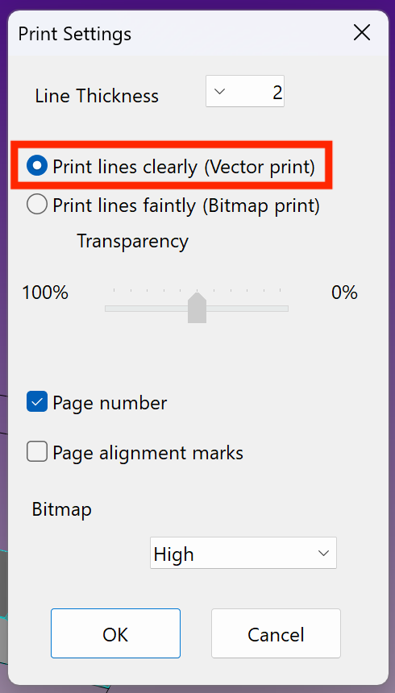

# pepakura-pdf-splitter-4-cricut

## [▶ Open the app](https://the8tre.github.io/pepakura-pdf-splitter-4-cricut/index.html)

A standalone web app that takes a **Pepakura Designer PDF** papercraft net and splits it into two files ready for a Cricut machine:

- **Cut file** — all solid lines (piece boundaries)
- **Fold file** — all dashed lines (mountain and valley folds)

Both output files share identical coordinates so Cricut overlays them with perfect alignment.

## Usage

Open `index.html` in any modern browser — no server or build step required.

1. Drop a Pepakura PDF onto the page (or click to browse)
2. Use the **PDF page** selector if the pattern spans multiple pages
3. Toggle **Both / Cut / Fold** to preview each layer
4. Download the Cricut SVG

## How it works

The app reads the PDF directly in the browser via [pdf.js](https://mozilla.github.io/pdf.js/). Each drawn stroke carries a dash state:

| Dash pattern | Layer |
|---|---|
| Solid (no dash) | Cut |
| Any dashed pattern | Fold |

Pepakura's line styles are user-configurable, so classification is based on solid vs. dashed, not on specific dash values. Both mountain (`- - -`) and valley (`- · - ·`) folds are merged into the single fold layer.

## Input format

PDFs exported from [Pepakura Designer](https://tamasoft.co.jp/pepakura-en/) (Tamasoft) via **File → Print to PDF…**

> ⚠️ In the Print Settings dialog, select **"Print lines clearly (Vector print)"**. The "Bitmap print" option rasterizes the lines and the app cannot process them.
>
> 

Multi-page layouts are supported — each page is processed independently.

## Files

| File | Description |
|---|---|
| `index.html` | The application — single self-contained HTML file |
